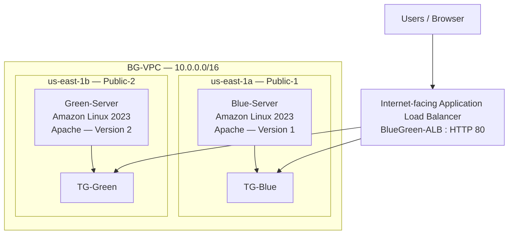

# AWS Blue-Green Deployment with Canary Traffic Shifting

A hands-on AWS project demonstrating two application environments (Blue and Green), an Application Load Balancer (ALB), EC2 target groups, and weighted forwarding for a gradual traffic rollout.

## Project goals

- Build a VPC with two public subnets in separate Availability Zones.
- Launch two EC2 web servers with different application versions.
- Register each server in its own target group.
- Configure an internet-facing Application Load Balancer.
- Use weighted target-group forwarding for an 80/20 canary-style rollout.
- Complete a 100% traffic cutover to the Green environment.

## Architecture



The ALB listener initially forwards to `TG-Blue`. During the canary-style stage, weighted forwarding is configured as Blue 80 / Green 20. The final cutover sets Blue to 0 and Green to 100.

## AWS services and tools

| Service | Purpose |
|---|---|
| Amazon VPC | Isolated network for the lab |
| Public subnets | Place the two EC2 instances in separate Availability Zones |
| Internet Gateway | Internet routing for the VPC |
| Route table | Routes `0.0.0.0/0` to the Internet Gateway |
| Amazon EC2 | Hosts the Blue and Green web servers |
| Security Groups | Control inbound traffic |
| Application Load Balancer | Single HTTP entry point and traffic distribution |
| Target Groups | Register instances and perform health checks |
| Apache HTTP Server | Serves the test webpages |

## Resource inventory

| Resource | Name / configuration |
|---|---|
| Region | `us-east-1` (N. Virginia) |
| VPC | `BG-VPC` — `10.0.0.0/16` |
| Public subnet 1 | `Public-1` — `10.0.1.0/24` — `us-east-1a` |
| Public subnet 2 | `Public-2` — `10.0.2.0/24` — `us-east-1b` |
| Internet Gateway | `BG-IGW` |
| Route table | `BG-RT` |
| EC2 security group | `Web-SG` |
| Blue instance | `Blue-Server` — `t3.micro` — Amazon Linux 2023 |
| Green instance | `Green-Server` — `t3.micro` — Amazon Linux 2023 |
| Blue target group | `TG-Blue` — HTTP:80 |
| Green target group | `TG-Green` — HTTP:80 |
| Load balancer | `BlueGreen-ALB` — Application Load Balancer |

## Implementation

### Task 1 — Create the VPC and public networking

1. In **VPC → Your VPCs → Create VPC**, create `BG-VPC` with IPv4 CIDR `10.0.0.0/16`.
2. Create `Public-1` in `us-east-1a` with CIDR `10.0.1.0/24`.
3. Create `Public-2` in `us-east-1b` with CIDR `10.0.2.0/24`.
4. For each subnet, enable **Auto-assign public IPv4 address**.
5. Create an Internet Gateway named `BG-IGW` and attach it to `BG-VPC`.
6. Create route table `BG-RT` in `BG-VPC`.
7. Add route `0.0.0.0/0` with target `BG-IGW`.
8. Associate both public subnets with `BG-RT`.

**Why this matters:** The subnet route to an attached Internet Gateway makes it a public subnet. An EC2 instance also needs a public IPv4 address (or another suitable public connectivity design) and permissive network/security rules to be reachable from the internet.

### Task 2 — Deploy the Blue environment (Version 1)

Launch an EC2 instance with:

| Setting | Value |
|---|---|
| Name | `Blue-Server` |
| AMI | Amazon Linux 2023 |
| Instance type | `t3.micro` |
| Key pair | Proceed without a key pair (lab setup) |
| VPC / subnet | `BG-VPC` / `Public-1` |
| Security group | `Web-SG` |
| Inbound rule | HTTP TCP 80 from `0.0.0.0/0` |

Under **Advanced details → User data**, use:

```bash
#!/bin/bash
yum update -y
yum install -y httpd
systemctl start httpd
systemctl enable httpd
echo '<html><body style="background-color:blue; color:white"><h1>🟦 VERSION 1 (BLUE)</h1></body></html>' > /var/www/html/index.html
```

After the instance has initialized and Apache is running, test:

```text
http://<Blue-Server-Public-IPv4>
```

Expected page label: `VERSION 1 (BLUE)`.

### Task 3 — Deploy the Green environment (Version 2)

Launch a second EC2 instance:

| Setting | Value |
|---|---|
| Name | `Green-Server` |
| AMI | Amazon Linux 2023 |
| Instance type | `t3.micro` |
| Key pair | Proceed without a key pair (lab setup) |
| VPC / subnet | `BG-VPC` / `Public-2` |
| Security group | Existing `Web-SG` |

Use this User Data script:

```bash
#!/bin/bash
yum update -y
yum install -y httpd
systemctl start httpd
systemctl enable httpd
echo '<html><body style="background-color:green; color:white"><h1>🟩 VERSION 2 (GREEN)</h1></body></html>' > /var/www/html/index.html
```

After initialization, test:

```text
http://<Green-Server-Public-IPv4>
```

Expected page label: `VERSION 2 (GREEN)`.

### Task 4 — Create target groups

In **EC2 → Target Groups → Create target group**, create:

| Setting | `TG-Blue` | `TG-Green` |
|---|---|---|
| Target type | Instances | Instances |
| Protocol | HTTP | HTTP |
| Port | 80 | 80 |
| VPC | `BG-VPC` | `BG-VPC` |
| Registered target | `Blue-Server` | `Green-Server` |

For each group, select the corresponding instance and choose **Include as pending below** before creating the target group.

Check the **Targets** tab and wait for health checks. Registration alone does not mean a target is healthy.

### Task 5 — Create the Application Load Balancer

1. Go to **EC2 → Load Balancers → Create load balancer**.
2. Select **Application Load Balancer**.
3. Name it `BlueGreen-ALB`.
4. Choose an **internet-facing** scheme for public browser access.
5. Select `BG-VPC` and both subnet mappings: `Public-1` (`us-east-1a`) and `Public-2` (`us-east-1b`).
6. Configure the security group to allow inbound HTTP on port 80.
7. Create an HTTP listener on port 80 with a default forward action to `TG-Blue`.
8. Create the load balancer and wait until its state is **Active**.

Use the ALB DNS name to test:

```text
http://<BlueGreen-ALB-DNS-Name>
```

With the Blue target healthy and the default listener action pointing to `TG-Blue`, the expected page is `VERSION 1 (BLUE)`.

### Task 6 — Shift traffic from Blue to Green

#### Stage A: Initial state — 100% Blue

Confirm the ALB DNS name serves the Blue version. The initial forwarding configuration is:

| Target group | Weight |
|---|---:|
| `TG-Blue` | 100 |
| `TG-Green` | 0 |

#### Stage B: Canary-style rollout — 80% Blue / 20% Green

1. Open `BlueGreen-ALB` and its **Listeners and rules** tab.
2. Edit the HTTP:80 listener's default forwarding action.
3. Add both target groups to the forwarding action.
4. Set `TG-Blue` weight to `80`.
5. Set `TG-Green` weight to `20`.
6. Save the changes and allow time for the configuration to update.
7. Send repeated requests to the ALB DNS name and observe which version is returned.

Weighted forwarding controls the relative distribution of requests across target groups over time. A small number of browser refreshes is not expected to produce an exact 80/20 count. Browser connection reuse and stickiness settings can also affect observations.

#### Stage C: Full cutover — 100% Green

Edit the forwarding action again:

| Target group | Weight |
|---|---:|
| `TG-Blue` | 0 |
| `TG-Green` | 100 |

Save the changes and test the same ALB DNS name. With Green healthy and the rule updated, new eligible requests should be routed to `TG-Green` and display `VERSION 2 (GREEN)`.

Keep Blue available until the Green environment is validated and a rollback decision has been made.

## Verification checklist

Mark each item only after checking it in your AWS environment.

- [ ] `BG-VPC` exists with CIDR `10.0.0.0/16`.
- [ ] Both public subnets exist in the intended Availability Zones.
- [ ] Public IPv4 auto-assignment is enabled on both subnets.
- [ ] `BG-IGW` is attached and `BG-RT` has the default internet route.
- [ ] Both subnets are associated with `BG-RT`.
- [ ] Blue instance serves the Version 1 page.
- [ ] Green instance serves the Version 2 page.
- [ ] Each target group contains its corresponding instance and the target is healthy.
- [ ] `BlueGreen-ALB` is Active and internet-facing.
- [ ] Initial ALB request serves Blue.
- [ ] 80/20 weighted forwarding is configured and tested.
- [ ] Final forwarding weights are Blue 0 / Green 100.
- [ ] ALB requests serve Green after the final cutover.

## Troubleshooting

### ALB DNS name does not open

Check that the ALB is internet-facing and Active, both public subnets are mapped, its security group permits inbound HTTP, and its network path is correctly configured.

### Target is unhealthy

Check that the EC2 instance is running, Apache has completed installation, the health-check path returns a successful response, and the instance security group permits traffic from the ALB security group. Also review network ACLs and routes.

### The expected traffic split is not obvious

Confirm that both target groups are included in the listener forwarding action with the intended weights and that both targets are healthy. Test with a larger number of requests; a few refreshes are not a statistically reliable sample.

### Green does not appear after cutover

Verify the listener's current forwarding action, Green target health, and the Green instance's own webpage. Make sure you are testing through the ALB DNS name.

## Security considerations

This is a learning lab, not a production security baseline. The supplied lab configuration uses a shared `Web-SG` security group for the ALB and instances and permits public HTTP access to the instances.

For a stronger design:

- Use a dedicated security group for the ALB.
- Allow public HTTP/HTTPS only to the ALB as required.
- Allow the EC2 instances to receive application traffic only from the ALB security group.
- Prefer private subnets for application instances where appropriate.
- Configure HTTPS with a valid TLS certificate.
- Use Systems Manager Session Manager or another controlled administration method rather than leaving instances without a planned access path.
- Review IAM permissions and logging.

## Cleanup

To avoid ongoing charges, remove resources when the lab is no longer needed. A typical dependency-aware order is:

1. Delete the Application Load Balancer.
2. Delete `TG-Blue` and `TG-Green`.
3. Terminate `Blue-Server` and `Green-Server`.
4. Delete `Web-SG` after no resource uses it.
5. Delete `BG-RT` after removing subnet associations.
6. Detach and delete `BG-IGW`.
7. Delete `Public-1` and `Public-2`.
8. Delete `BG-VPC`.

Check the AWS console for remaining resources and charges. Do not delete shared resources used by other projects.

## Key learnings

- VPC and subnet design across Availability Zones.
- Internet Gateway and route-table configuration.
- EC2 launch configuration and User Data automation.
- Apache web-server installation and service management.
- Target group registration and health checks.
- Application Load Balancer listeners and forwarding actions.
- Weighted traffic distribution and a canary-style rollout.
- Final application cutover and deployment verification.


**Project status:** Hands-on lab documentation prepared. Update the verification checklist and add genuine implementation screenshots before presenting every result as verified.
